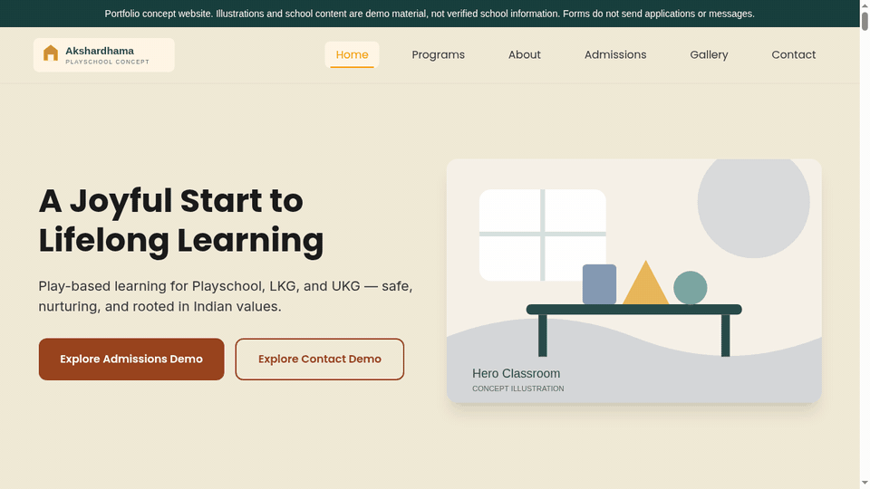

# Playschool Website Concept

A static frontend learning project for a playschool-style website, built with HTML, CSS, and browser JavaScript. It includes program sections, gallery filters, responsive navigation, and client-side form validation.



Live demo: https://prakruthi401.github.io/school_website/

## Preview

```sh
python -m http.server 8000
```

Open `http://localhost:8000`. No packages, API keys, database, or build step are required.

## What the demo includes

- Desktop and mobile navigation with section links.
- Program and admissions layouts.
- Filterable image gallery.
- Form validation in the browser.
- Original geometric SVG classroom illustrations in place of the old broken image placeholders. These are illustrations, not school photographs.

## Important limits

This is a portfolio concept, not an official school website. Names, school details, fees, staff descriptions, testimonials, and contact information in the design are unverified demonstration content. Do not rely on them to contact or assess a school.

Forms do not submit applications or messages, send email, or save records. Use fictional data only. The video and map areas are interface examples, not working services. Before any actual school launch, replace all sample content with approved facts and licensed photos, remove demo content, add a working secure form service and privacy notice, and test the complete site with the school.
